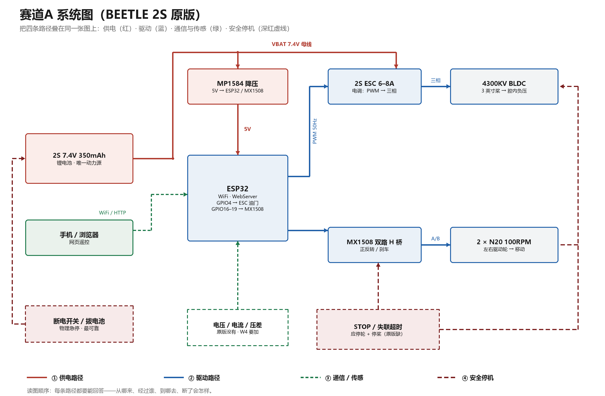

# 系统架构与四条路径（BEETLE 2S 原版）

> 红=供电，蓝=驱动，绿=通信/传感，深红虚线=安全停机。

## 1. 系统框图

- **吸附链**：2S 7.4V → 6–8A ESC → 4300KV 无刷 + 3″ 桨 → 腔内负压
- **行走链**：ESP32 → MX1508（VM=5V）→ 2×N20 100RPM → 左右轮
- **控制**：手机浏览器 → WiFi → ESP32 网页 → GPIO4（PWM）/ GPIO16–19（方向）
- **监测**：目前无电压/电流/压差采样，W4 前补

## 2. 供电路径

| 段 | 起点 → 终点 | 电压 | 电流 | 保护/开关 | 断了会怎样 |
|---|---|---|---|---|---|
| P1 | 2S 电池 → 分电 | 7.4 V（满电 8.4 V） | 峰值 6–8 A | 待定：开关 + 保险 | 全系统失电 |
| P2 | 分电 → ESC → 无刷 | 7.4 V | 6–8 A | ESC 低压保护 | 桨停，吸附消失 |
| P3 | 分电 → MP1584 → 5 V | 7.4 V → 5 V | <2 A | 降压模块 | 控制与行走掉电 |
| P4 | 5 V → ESP32 / MX1508 | 5 V | <2 A | 待定 | 控制失效，需物理断电 |

**共地**：电池负极 → MP1584 输入地 → ESP32 GND → MX1508 GND，单点汇合。

## 3. 驱动路径

| 控制信号 | 驱动级 | 执行器 | 机械输出 | 异常 |
|---|---|---|---|---|
| GPIO4，50 Hz PWM，1000–2000 µs | 6–8A ESC（建议 10A） | 4300KV + 3″ 桨 | 负压 → 吸附力 | 过流/异响：断电极 |
| GPIO16–19 电平 | MX1508（VM=5V） | 2×N20 100RPM | 轮速/转向 | 堵转、发热：停轮检查 |

- MX1508：IN1/IN2 同高 = 刹车，同低 = 滑行。
- 桨起转前必须净空并固定防护。

## 4. 传感路径

| 物理量 | 传感器 | 接口 | 量程 | 位置 | 现状 |
|---|---|---|---|---|---|
| 电池电压 | 分压 | ADC | 0–8.4 V | 电池出口 | 缺 |
| 总电流 | INA219 / ACS712 | I2C / ADC | 0–10 A | ESC 供电线 | 缺 |
| 腔体压差 | 差压传感器 | I2C / 模拟 | ±2 kPa 级 | 腔体侧壁 | 缺 |
| 指令 | 手机浏览器 | WiFi | — | — | 已有 |

## 5. 安全停机路径

| 触发 | 检测 | 动作 | 目标时延 | 验证 |
|---|---|---|---|---|
| 人员发现异常 | 观察员 | 拔电池 / 台架断电 | 立即 | 每次实验前演练 |
| 网页 STOP | 操作手 | 停轮 + 停桨 | <100 ms | 日志 |
| 通信失联 | 固件超时 | 停轮 + 停桨 | ≤0.5 s | W2 断联测试（当前不满足） |
| 过流/异常振动 | 传感器/人 | 停机隔离 | W4 定阈值 | 阈值实验 |

## 6. 控制逻辑

- 上电默认：PWM=1000 µs，电机 0，不自动转。
- 失联：0.5 s 内停机（待实现）。
- 限幅：油门上限与 N20 占空比上限 W2 实测后确定。
- 解锁：改为手动解锁，避免复位即重新 arm。

## 7. 与原版的一致性

本方案严格按 BEETLE 2S 原版：器件、引脚、供电电压一致，无改型差异。
3S + 50mm 涵道方案列为候选 B（见 `hardware_BOM.md` 附录），W5 视进度决定是否做对照。

## 8. 待确认项

- [ ] 电池出口是否加独立开关与保险丝
- [ ] 压差传感器量程与安装位置
- [ ] 断联停车的实现方式
- [ ] 裙边材料与固定方式
- [ ] 5V 是否同时给 MX1508 供电（原版如此）

## 附录：候选 B（3S 涵道，暂不实施）

3S 11.1V → 40A ESC → 50mm EDF（4900KV，标称 780 g / 38 A）；整机约 294 g，续航约 1.5 min。
差异 4 项：电压、推进、主控（S3）、质量，均需重新验证。仅在 W5 有余力时做对照。
